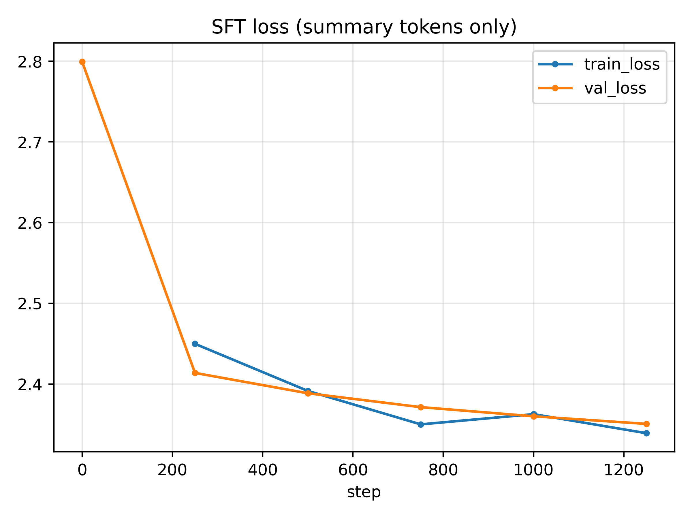
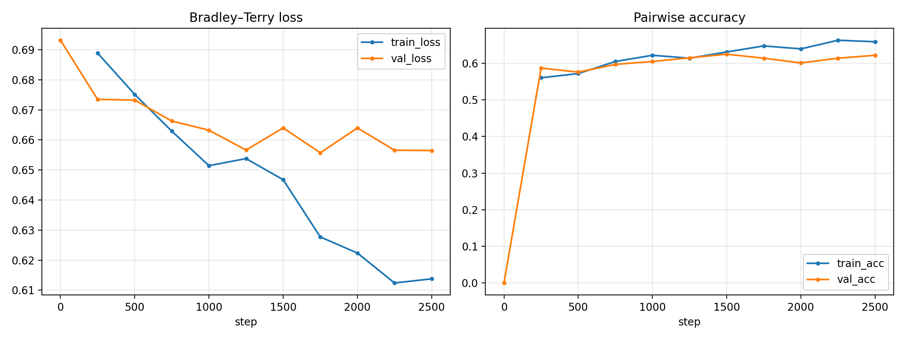
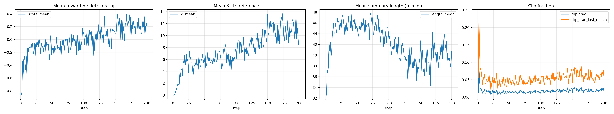
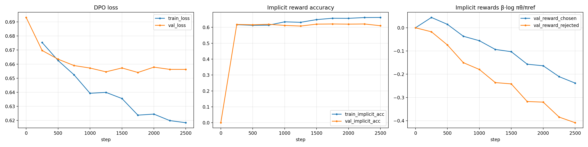
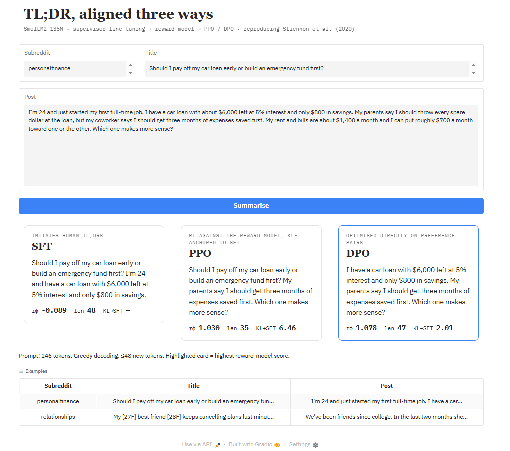

# RLHF for Reddit TL;DR — SFT → Reward Model → PPO / DPO

A from-scratch reproduction of *Learning to Summarize from Human Feedback* (Stiennon et al., 2020) on
**SmolLM2-135M**, fully fine-tuned. The SFT loss, the Bradley–Terry reward model, PPO and DPO are written by
hand in PyTorch. No RLHF library is used.

```
Reddit post ──► Stage 1  SFT          imitate human TL;DRs                     checkpoints/sft
                Stage 2  Reward model  rφ(x, y) from 20k ranked pairs           checkpoints/reward
                Stage 3  PPO          maximise rφ − β·KL(π‖π_SFT)              checkpoints/ppo
                Stage 4  DPO          same goal, directly from the ranked pairs checkpoints/dpo
                            └──► compare SFT / PPO / DPO on 300 held-out posts
```

| | Link |
|---|---|
| Checkpoints | [`latent-hassan/smollm2-135m-tldr-{sft,reward,ppo,dpo}`](https://huggingface.co/latent-hassan) on the Hugging Face Hub |
| Blog | _Medium link_ |
| LinkedIn | _post link_ |

---

## Repository layout

```
starter/            given files, unchanged
common.py           token_logprobs, summary_mask, generation/rollout helpers, logging, plotting, Task 1
train_sft.py        Task 2 — SFT
train_reward.py     Task 3 — RewardModel class + Bradley–Terry training
train_ppo.py        Task 4 — value head, rollout, per-token rewards, returns/advantages, PPO loss
train_dpo.py        Task 5 — DPO
evaluate.py         Task 6 — metrics, human-eval sheets, tables, samples, Task 7 numbers
results/            logs, tables, figures, summaries, human evaluation, analysis.md
app/app.py          Task 8 — Gradio front end
Makefile            one target per task
```

Design rules: every spec hyperparameter is an UPPERCASE constant at the top of its script with the PDF section
cited. All shared logic lives in `common.py`. Every stage logs JSON lines to `results/logs/<stage>.jsonl`, and the
tables and figures are rebuilt from those logs. The correctness checks in §3.3 are `assert`s that run during
training and are appended to `results/correctness_checks.txt`.

## Constraint compliance

- One base model, `HuggingFaceTB/SmolLM2-135M`, fully fine-tuned in every stage.
- `transformers` is used only for `AutoTokenizer`, `AutoModelForCausalLM` and `model.generate`. The reward model and
  value head use the causal LM's own transformer body (`model.model`) plus an `nn.Linear`. No `labels=` argument is
  used, because the SFT loss is computed by hand.
- None of `trl`, `peft`, `trlx`, OpenRLHF, DeepSpeed-Chat, `Trainer` or `AutoModelForSequenceClassification` is used.
- `starter/` is byte-for-byte the provided code and is imported through `sys.path`.
- Checkpoints live on the Hugging Face Hub and are never committed (`.gitignore`).

## Setup

```bash
git clone https://github.com/MeMorphLing/<repo>.git && cd <repo>
pip install -r requirements.txt
make starter      # Task 1.1 — the unchanged starter check
make task1        # Task 1.2–1.3 — Table 1 statistics + summary-mask check
```

Hardware: a single free **T4 (16 GB)** on Colab or Kaggle. Mixed precision is fp16 autocast with fp32 master
weights and a `GradScaler`. `RLHF_AMP=0` disables it.

## Run everything (in order)

```bash
make smoke && make clean   # optional 2-minute dry run on tiny slices — catches bugs before the long runs
make sft                   # Task 2  → checkpoints/sft,    fig1
make reward                # Task 3  → checkpoints/reward, fig2       (needs sft)
make dpo                   # Task 5  → checkpoints/dpo,    fig4       (needs sft; can run in parallel with reward)
make ppo                   # Task 4  → checkpoints/ppo,    fig3       (needs sft + reward)
make eval                  # Task 6  → results/eval_summaries.jsonl, results/tables.md
make human-sheet           # §3.2    → one blind sheet per rater
make human-score NOTE="…"  # §3.2    → results/human_eval.csv, Table 4
make samples               # §4.6    → results/samples.md (then write the *Why* lines)
make analysis              # Task 7  → results/analysis_data.md (numbers for analysis.md)
make app                   # Task 8  → http://127.0.0.1:7860
make upload                # push checkpoints to the Hub
```

**Out of GPU memory?** Use `MICRO_BATCH=8 make <stage>`. The batch is then processed in two halves and the
gradients are accumulated before a single `optimizer.step()`. Losses are normalised by the token or pair count of
the *whole* batch, so the update is mathematically identical, and no spec setting changes.

**Colab/Kaggle disconnected during PPO?** A resume state is saved every 50 iterations. Run
`RESUME=1 make ppo` to continue with the same prompts, optimiser state and RNG.

**Front end only:** `make download && make app`

## Implementation notes

| Topic | What the code does |
|---|---|
| Log-prob indexing | `token_logprobs` returns (B, L−1); column *j* = log π(x_{j+1} \| x_≤j). `summary_mask` is aligned to it and is 1 exactly on the summary tokens including EOS. |
| Padding | pad = eos in this tokenizer, so real tokens are always found with `attention_mask`. Every forward pass gets `position_ids = cumsum(mask) − 1`, so left-padded inputs see the same positions `generate()` used. |
| Reward model | Final hidden state of the last real token (via `attention_mask`), then `nn.Linear(576, 1)`. Chosen and rejected go through one forward pass. |
| PPO alignment | log π(a_t\|s_t) and V(s_t) are read from the same position (P+t−1), the one whose logits predict a_t. The LM head is applied only to response positions. |
| PPO rollout | Samples with T = 1, top-k 0, top-p 1, up to 48 tokens. Everything after the first EOS is masked out, and the rφ score is added at that last token. |
| PPO objective | r_t = −β(log π_old − log π_ref) + 1[t=T]·rφ, γ = 1 returns, advantages normalised over all generated tokens, K = 4 full-batch epochs, loss = −L_CLIP + 0.1·L_V − 0.01·H, with every mean over generated tokens. |
| DPO | log π(y\|x) = sum over summary tokens. Loss = −log σ(β[(log π_θ − log π_ref)(y_w) − (log π_θ − log π_ref)(y_l)]) with β = 0.1. |
| Evaluation | Greedy decoding, up to 48 tokens. Reports rφ, win rate vs SFT (strictly higher rφ), KL to SFT on the method's own summary, length (tokens incl. EOS) and ROUGE-L F (rouge-score, Porter stemmer), with 95% bootstrap CIs. |

## Results

All four tables are in [`results/tables.md`](results/tables.md). Figures:

| | |
|---|---|
|  |  |
|  |  |

Qualitative samples: [`results/samples.md`](results/samples.md). Analysis (Task 7): [`results/analysis.md`](results/analysis.md).

## Correctness checks (§3.3)

The training scripts assert these and append them to `results/correctness_checks.txt`. Paste that file here
after the final run.

```
<paste results/correctness_checks.txt>
```

| Check | Where |
|---|---|
| Summary mask decodes to exactly summary + EOS | `common.py` (Task 1) |
| πref and rφ have `requires_grad=False` in Stages 3 and 4 | `train_ppo.py`, `train_dpo.py` |
| PPO iteration 1: KL to reference = 0 | `train_ppo.py` |
| PPO every iteration: r_t(θ) = 1 and clip fraction = 0 in the first epoch | `train_ppo.py` |
| DPO first step: loss = log 2 | `train_dpo.py` |
| Left-padded prompts; reward model reads the last real token | `train_reward.py`, `train_ppo.py` |

## Human evaluation protocol

This is an individual project. Each of two raters gets an independently shuffled blind sheet
(`human_eval_blind_r{1,2}.csv`) for the same 30 posts (fixed seed). Neither rater sees which model wrote which
summary. Picks are mapped back with `human_eval_key.json` only after both sheets are complete.
_Describe here who rater 2 was (e.g. an external, blind rater) or, if the instructor approved a single-rater
protocol, how it was done._

## Front end

`make app` loads the four local checkpoints. You paste a post and get the SFT, PPO and DPO summaries side by side,
each with its reward-model score, length, and KL to SFT. Prompts longer than 448 tokens are trimmed to fit.



## Author

Muhammad Hassan Tahir — [GitHub @MeMorphLing](https://github.com/MeMorphLing) · [Medium @hassantahir318](https://medium.com/@hassantahir318)
